# Distribuição de Amostragem {#chap08}

## Introdução

Numa população de $N$ elementos podem-se extrair diferentes amostras aleatórias de $n$ elementos. Para cada amostra é possível determinar uma estatística, como por exemplo, a média e a variância. Os valores dessas estatísticas variam de amostra para amostra, apresentando uma distribuição amostral. Dessa forma, o conhecimento das distribuições amostrais é importante, para que as inferências sobre os parâmetros da população com base em informações contidas nas amostras tenham validade.

## Distribuição Amostral da Média

### Amostragem em Populações com Distribuição Normal {#sec-distmedia01}

Suponha que várias amostras aleatórias de tamanho $n$, sejam retiradas de uma população normalmente distribuída, de média $\mu$ e variância $\sigma^2$, calculando para cada amostra a média amostral, então a distribuição das médias amostrais também possuirá uma distribuição normal com:

- Média:

$$
\mu_{\bar{x}}=\mu
$$

- Variância:

$$
\sigma_{\bar{x}}^2=\frac{\sigma^2}{n}
$$

A @fig-damedia mostra a representação gráfica da distribuição.

```{r}
#| echo: false
#| label: fig-damedia
#| fig-cap: "Distribuição de $\\bar{x}$."
#| out-width: "60%"
#| fig-align: "center"

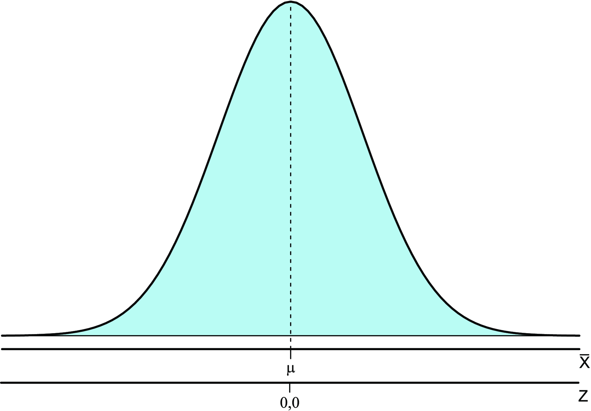
```

Em notação usa-se:

$$
\bar{x} \sim N\left(\mu; \frac{\sigma^2}{n} \right)
$$

A transformação de $Z$ é dada por:

$$
Z=\frac{\bar{x}-\mu}{\frac{\sigma}{\sqrt{n}}}
$$ {#eq-zmedia}

em que $Z \sim N(0,0; 1,0)$.


:::{#exm-}

Seja uma variedade de milho, em que a altura ($X$) segue uma distribuição normal, de média 201,0 cm e variância 242,0 cm$^2$.

Assim,

$$
X \sim N(201,0; 242,0)
$$

Retirando-se nesta população amostras aleatórias de 25 plantas, a distribuição amostral da média é uma distribuição normal com:

- Média:

$$
\mu_{\bar{x}}=\mu=201,0 \text{ cm}
$$

- Variância:

$$
\sigma_{\bar{x}}^2=\frac{\sigma^2}{n}=\frac{242,0}{25}=9,68 \text{ cm}^2
$$

Assim, pode-se, por exemplo, determinar a probabilidade de $\bar{x}$ ser maior que 205,0 cm.

$$
P(\bar{x}>205,0)=?
$$

Tem-se que o valor de $Z$ calculado através da Equação @eq-zmedia, é dado por:

$$
Z=\frac{205,0-201,0}{\frac{15,56}{\sqrt{25}}}=1,29
$$

Assim,

$$
P(\bar{x}>205,0)=P(Z>1,29)=0,5-P(0,0 < Z < 1,29)
$$

Consultando a Tabela de $Z$ (Tabela @tab-normal01), tem-se que:

$$
P(0,0 < Z < 1,29)=0,4015
$$

Logo,

$$
P(\bar{x}>205,0)=0,5-0,4015=0,0985=9,85\%
$$

cuja representação gráfica é dada na @fig-exem81.

```{r}
#| echo: false
#| label: fig-exem81
#| fig-cap: "Área correspondente a probabilidade de $\\bar{x}$ ser maior que 205,0 cm."
#| out-width: "60%"
#| fig-align: "center"

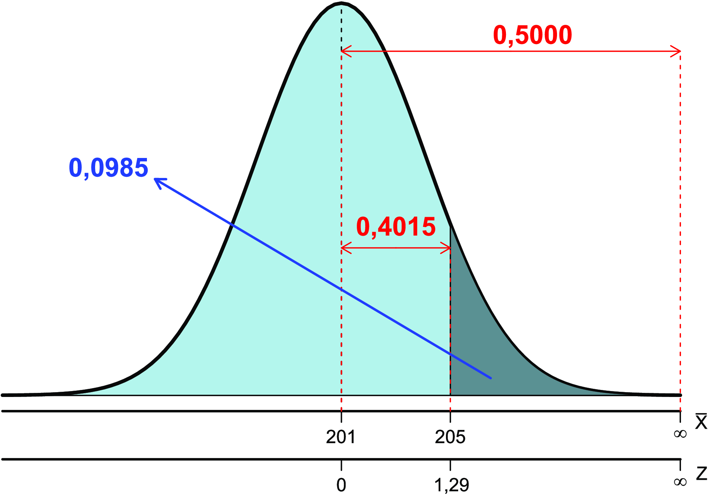
```

:::

### Amostragem em Populações com Qualquer Distribuição de Probabilidades {#sec-distmedia02}

Suponha que várias amostras aleatórias de tamanho $n$, sejam retiradas de uma população com qualquer distribuição de probabilidades, de média $\mu$ e variância $\sigma^2$, a distribuição das médias amostrais será uma distribuição normal aproximada com:

- Média:

$$
\mu_{\bar{x}}=\mu
$$

- Variância:

$$
\sigma_{\bar{x}}^2=\frac{\sigma^2}{n}
$$

Em notação usa-se:

$$
\bar{x} \sim N_{\text{Aproximada}}\left(\mu; \frac{\sigma^2}{n} \right)
$$

A representação gráfica é dada pela @fig-tlc.


```{r}
#| echo: false
#| out-width: "60%"
#| fig-align: "center"
#| label: fig-tlc
#| fig-cap: "Distribuição de $\\bar{x}$."


```

Este resultado é conhecido como **Teorema Central do Limite**, cujo valor da transformação $Z$ é dado por:

$$
Z=\frac{\bar{x}-\mu}{\frac{\sigma}{\sqrt{n}}}
$$ {#eq-zmedia1}

em que $Z \sim N(0,0; 1,0)$.

::: {#exm-tlcbinomial}

Numa população qualquer, determinada variável $X$ tem distribuição binomial com:

$$
\mu=5,0 \text{ e } \sigma^2=16,0
$$

Retirando-se nesta população amostras aleatórias com $n = 16$ elementos, calculando-se as médias em cada amostra, a distribuição amostral da média é uma distribuição normal aproximada com:

- Média:

$$
\mu_{\bar{x}}=\mu=5,0
$$

- Variância:

$$
\sigma_{\bar{x}}^2=\frac{\sigma^2}{n}=\frac{16,0}{16}=1,0
$$

ou seja,

$$
\bar{x}\sim N_{\text{Aproximada}}(5,0; 1,0)
$$

:::

::: {#exm-tlcdiscreta}

Seja uma população com distribuição uniforme discreta, composta dos números 1, 2, 3 e 4.

Assim,

$$
P(X=x)=
\begin{cases}
\frac{1}{4} & \textrm{para } x = 1, 2, 3, 4 \\
0,0 & \textrm{para outros valores de } x
\end{cases}
$$

A média da população calculada através da Equação @eq-expd é dada por:

$$
\mu=
1\left(\frac{1}{4} \right)+
2\left(\frac{1}{4} \right)+
3\left(\frac{1}{4} \right)+
4\left(\frac{1}{4} \right)=
\frac{10}{4}=
\frac{5}{2}=2,5
$$

Para o cálculo da variância tem-se que a $E(X^2)$ é calculado através da Equação @eq-vd, e dada por:

$$
E(X^2)=
1^2\left(\frac{1}{4} \right)+
2^2\left(\frac{1}{4} \right)+
3^2\left(\frac{1}{4} \right)+
4^2\left(\frac{1}{4} \right)=
\frac{30}{4}
$$

Logo, a variância da população calculada através da Equação @eq-varal é dada por:

$$
\sigma^2=
\frac{30}{4}-
\left(\frac{5}{2} \right)^2=
\frac{5}{4}
$$

Assim, o desvio padrão calculado através da Equação @eq-dpam é dado por:

$$
\sigma=
\sqrt{\frac{5}{4}}=
\frac{\sqrt{5}}{2}
$$

Para determinar a distribuição amostral da média, considere todas as possíveis amostras com $n = 2$, tomadas com reposição, e suas respectivas médias:

| Amostras | Médias |
|:---:|:---:|
| (1, 1) (2, 1) (3, 1) (4, 1) | 1,0  1,5  2,0  2,5 |
| (1, 2) (2, 2) (3, 2) (4, 2) | 1,5  2,0  2,5  3,0 |
| (1, 3) (2, 3) (3, 3) (4, 3) | 2,0  2,5  3,0  3,5 |
| (1, 4) (2, 4) (3, 4) (4, 4) | 2,5  3,0  3,5  4,0 |

: { .striped .hover}

A distribuição amostral das médias é dada por:

| $\bar{x_i}$ | $F_i$ | $P(\bar{x_i})$ |
|:---:|:---:|:---:|
| 1,0 | 1 | $\frac{1}{16}$ |
| 1,5 | 2 | $\frac{2}{16}$ |
| 2,0 | 3 | $\frac{3}{16}$ |
| 2,5 | 4 | $\frac{4}{16}$ |
| 3,0 | 3 | $\frac{3}{16}$ |
| 3,5 | 2 | $\frac{2}{16}$ |
| 4,0 | 1 | $\frac{1}{16}$ |
| - | **16** | **1,0** |

: { .striped .hover}

A média da distribuição amostral de $\bar{x}$ calculada através da Equação @eq-expd é dada por:

$$
\mu=
1,0\left(\frac{1,0}{16} \right)+
1,5\left(\frac{2}{16} \right)+
\cdots+
4,0\left(\frac{1}{16} \right)=
\frac{40}{16}=
\frac{10}{4}=2,5
$$

Tem-se que $E(\bar{x}^2)$ calculado através da Equação @eq-vd é dado por:

$$
E(\bar{x}^2)=
1,0^2\left(\frac{1,0}{16} \right)+
1,5^2\left(\frac{2}{16} \right)+
\cdots+
4,0^2\left(\frac{1}{16} \right)=
\frac{110}{16}
$$

Assim, a variância da população calculada através da Equação @eq-varal é dada por:

$$
\sigma^2=
\frac{110}{16}-
\left(\frac{10}{4} \right)^2=
\frac{5}{8}
$$

Logo, o desvio padrão calculado através da Equação @eq-dpam é dado por:

$$
\sigma=
\sqrt{\frac{5}{8}}=
\frac{\sqrt{5}}{2\sqrt{2}}
$$

Pelos resultados observa-se que:

- Média:

$$
\mu_{\bar{x}}=\mu
\Rightarrow
\frac{5}{2}=\frac{5}{2}
$$

- Desvio padrão:

$$
\sigma_{\bar{x}}=
\frac{\sigma}{\sqrt{n}}
\Rightarrow
\frac{\sqrt{5}}{2\sqrt{2}}=
\frac{\frac{\sqrt{5}}{2}}{\sqrt{2}}=
\frac{\sqrt{5}}{2\sqrt{2}}
$$

O que indica que os resultados estão de acordo com o Teorema Central do Limite.

A @fig-distx mostra a distribuição da variável $X$, e a @fig-tlcxbar a distribuição de $\bar{x}$.


```{r}
#| label: fig-distx
#| fig-cap: "Distribuição de $\\bar{x}$."
#| echo: false
#| out-width: "60%"
#| fig-align: "center"

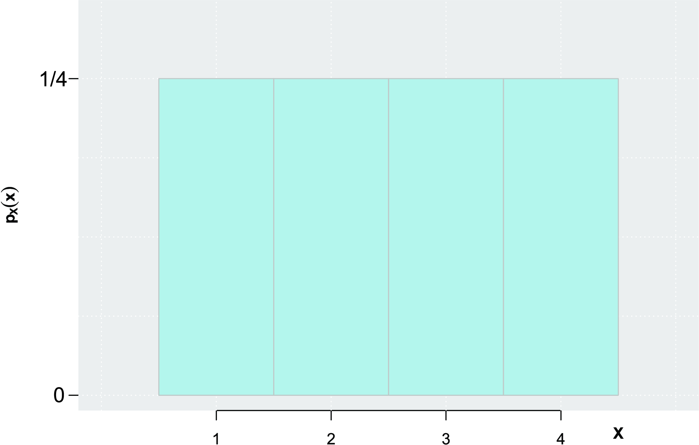
```


```{r}
#| label: fig-tlcxbar
#| fig-cap: "Distribuição de $\\bar{x}$."
#| echo: false
#| out-width: "60%"
#| fig-align: "center"

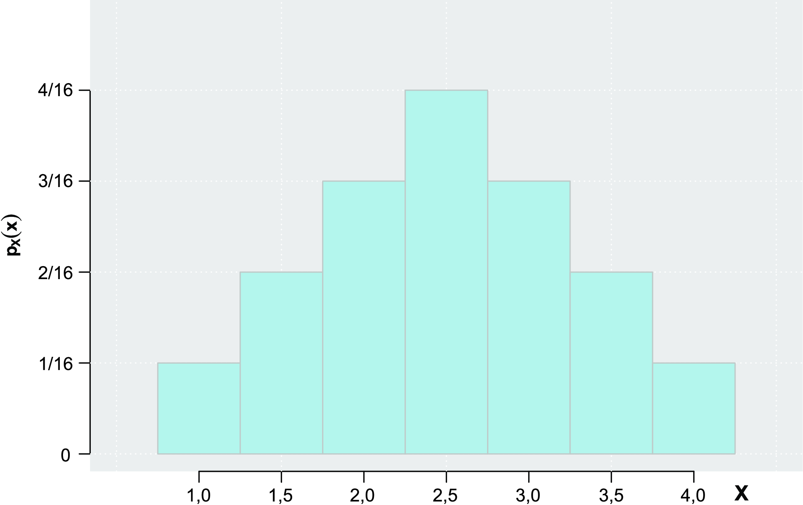

```


:::

## Distribuição Amostral da Diferença entre Duas Médias

Se várias amostras aleatórias independentes, de tamanhos $n_1$ e $n_2$, são retiradas de duas populações, de médias $\mu_1$ e $\mu_2$, e variâncias $\sigma_1^2$ e $\sigma_2^2$, respectivamente, determinando-se em cada amostra a média amostral. A distribuição amostral das diferenças entre as médias amostrais $(\bar{x}_1 - \bar{x}_2)$, será uma distribuição normal aproximada com:

- Média:

$$
\mu_{\bar{x}_{1}-\bar{x}_{2}}=\mu_{1} - \mu_{2}
$$

- Variância:

$$
\sigma_{\bar{x}_{1}-\bar{x}_{2}}^{2}=
\frac{\sigma_{1}^2}{n_1}+
\frac{\sigma_{2}^2}{n_2}
$$

Em notação, a distribuição para a diferença entre duas médias amostrais $(\bar{x}_1 - \bar{x}_2)$, é dada por:

$$
{\bar{x}_{1}-\bar{x}_{2}}
\sim
N_{\text{Aproximada}}
\left(
\mu_{1} - \mu_{2};
\frac{\sigma_{1}^2}{n_1}+
\frac{\sigma_{2}^2}{n_2}
\right)
$$

A transformação de $Z$ é dada pela Equação @eq-zdifmedia.

$$
Z=
\frac{
(\bar{x}_{1}-\bar{x}_{2})-(\mu_{1} - \mu_{2})
}{
\frac{\sigma_1}{\sqrt{n_1}}+
\frac{\sigma_2}{\sqrt{n_2}}
}
$$ {#eq-zdifmedia}

em que $Z \sim N(0,0; 1,0)$.

A representação gráfica é dada pela @fig-damediaduasamostras.


```{r}
#| label: fig-damediaduasamostras
#| fig-cap: "Distribuição de $(\\bar{x}_1 - \\bar{x}_2)$."
#| echo: false
#| out-width: "60%"
#| fig-align: "center"

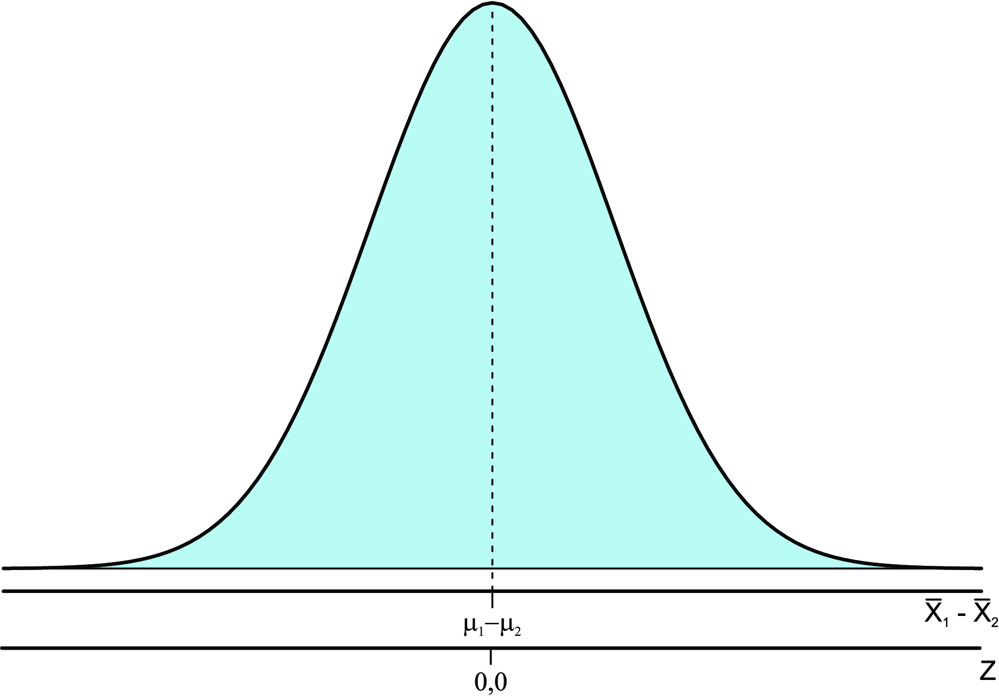

```

::: {#exm-difduasmedias}

Sejam:

$$
X_1 : \text{Peso, em kg, de suínos da raça 1}
$$

$$
X_2 : \text{Peso, em kg, de suínos da raça 2}
$$

Considere que:

$$
X_1 \sim N(110,0; 166,0)
$$

$$
X_2 \sim N(107,0; 127,0)
$$

Se da população de suínos da raça 1 e da raça 2, são retiradas amostras de tamanhos $n_{1} = 10$ e $n_{2} = 11$, respectivamente, determinar:

$$
P[(\bar{x}_{1}-\bar{x}_{2})>4,0]
$$

Tem-se então que a distribuição amostral das diferenças entre as médias amostrais é uma distribuição normal com:

- Média:

$$
\mu_{\bar{x}_{1}-\bar{x}_{2}}=
\mu_{1} - \mu_{2}=
110,0-107,0=
3,0 \text{ kg}
$$

- Variância:

$$
\sigma_{\bar{x}_{1}-\bar{x}_{2}}^{2}=
\frac{\sigma_{1}^2}{n_1}+
\frac{\sigma_{2}^2}{n_2}=
\frac{166,0}{10}+
\frac{127,0}{11}=
16,60+11,55=
28,15 \text{ kg}^{2}
$$

O valor da transformação $Z$ é calculado através da Equação @eq-zdifmedia, e dado por:

$$
Z=
\frac{4,0-3,0}{\sqrt{28,15}}=
0,19
$$

Consultando a Tabela de $Z$ (@tab-normal01), tem-se que:

$$
P(0,0<Z<0,19)=0,0753
$$

Logo, segue que:

$$
P[(\bar{x}_{1}-\bar{x}_{2})>4,0]
=
P(Z>0,19)=
0,5-P(0,0<Z<0,19)
$$

$$
=
0,5-0,0753=
0,4247=
42,47\%
$$

cuja representação gráfica é apresentada na @fig-exem85.

```{r}
#| label: fig-exem85
#| fig-cap: "Área correspondente à probabilidade de $(\\bar{x}_1 - \\bar{x}_2)$ ser maior que $4,0$ kg."
#| echo: false
#| out-width: "60%"
#| fig-align: "center"

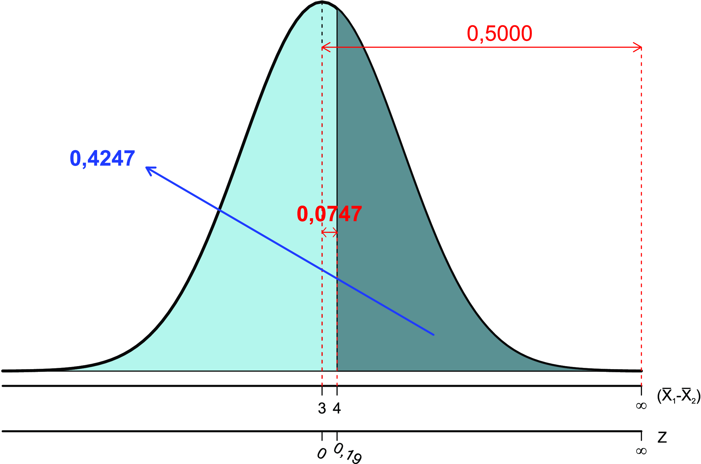

```

:::

## Distribuição Amostral das Proporções

Numa amostra aleatória de $n$ elementos, obtém-se uma estimativa da proporção $p$ de elementos com determinada característica da população, através da expressão @eq-prop.

$$
\hat{p}=\frac{x}{n}
$$ {#eq-prop}

em que $x$ é uma variável aleatória que representa o número de elementos da amostra com a característica desejada.

Se todas as possíveis amostras aleatórias de tamanho $n$ são extraídas de uma população infinita com distribuição Binomial de parâmetros $n$ e $p$, cuja média é $np$ e variância $np(1-p)$. A distribuição amostral da proporção $\hat{p}$ será uma distribuição binomial com:

- Média:

$$
\mu_{\hat{p}}=p
$$

- Variância:

$$
\sigma_{\hat{p}}^{2}=\frac{p(1-p)}{n}
$$

Para $n$ grande, a distribuição é aproximadamente normal, em que de acordo com o Teorema Central do Limite, o valor da transformação $Z$ é dado pela expressão @eq-zprop.

$$
Z=
\frac{
\hat{p}-p
}{
\sqrt{
\frac{p(1-p)}{n}
}
}
$$ {#eq-zprop}

em que $Z\sim N(0,0; 1,0)$.

## Distribuição Amostral para a Diferença entre Duas Proporções

Sejam $p_1$ e $p_2$ a proporção de elementos em duas populações 1 e 2, respectivamente, com uma determinada característica. Os estimadores pontuais de $p_1$ e $p_2$ são dados por:

$$
\hat{p_1} = \frac{x_1}{n_1}
\quad \text{e} \quad
\hat{p_2} = \frac{x_2}{n_2},
$$

respectivamente.

Em que $x_1$ e $x_2$ são o número de elementos nas amostras $n_1$ e $n_2$, extraídas das populações 1 e 2, respectivamente, com a característica desejada.

Tem-se que para $n_1$ e $n_2$ grandes, $\hat{p_1} - \hat{p_2}$ tem distribuição normal aproximada com:

- Média:

$$
\mu_{\hat{p_1}-\hat{p_2}}=p_{1}-p_{2}.
$$

- Variância:

$$
\sigma_{\hat{p_1}-\hat{p_2}}^{2}=
\frac{p_{1}(1-p_{1})}{n_1}+
\frac{p_{2}(1-p_{2})}{n_2}.
$$

Em notação, tem-se:

$$
\hat{p_1}-\hat{p_2}
\sim
N_{\text{Aproximada}}
\left(
p_{1}-p_{2},
\frac{p_{1}(1-p_{1})}{n_1}+
\frac{p_{2}(1-p_{2})}{n_2}
\right).
$$

O valor da transformação $Z$ é dado pela Equação @eq-z2prop022.

$$
Z=
\frac{
(\hat{p}_1-\hat{p}_2)-(p_{1}-p_{2})
}{
\sqrt{
\frac{p_{1}(1-p_{1})}{n_1}+
\frac{p_{2}(1-p_{2})}{n_2}
}
}
$$ {#eq-z2prop022}

em que $Z \sim N(0,0; 1,0)$.

## Outras Distribuições Amostrais

Existem algumas outras distribuições teóricas de probabilidades, que são usadas como ferramentas para construção de intervalos de confiança e testes de hipóteses, os quais serão vistos nos próximos capítulos. A seguir são apresentadas algumas dessas distribuições.

### Distribuição de Qui-quadrado

A distribuição de Qui-quadrado ($\chi^2$) corresponde à distribuição da soma de $n$ variáveis aleatórias independentes ao quadrado, com distribuição normal padronizada ($Z$), ou seja:

$$
\chi^2=Z_{1}^{2}+Z_{2}^{2}+Z_{3}^{2}+\cdots+Z_{n}^{2}.
$$

Sua função densidade de probabilidade é dada por:

$$
f(y)=
\frac{
y^{\left(\frac{\nu}{2}\right)-1}e^{-\frac{\nu}{2}}
}{
2^{\frac{\nu}{2}}
\Gamma\left(\frac{\nu}{2}\right)
},
\quad y \ge 0,
$$

em que:

- $y$ é a variável aleatória com distribuição de Qui-quadrado com $\nu$ graus de liberdade;
- $e$ é a base dos logaritmos neperianos, igual a $2,7183\ldots$;
- $\Gamma$ é a função Gama;
- $\nu$ representa o parâmetro da distribuição, chamado de graus de liberdade, dado por: $\nu=n-1$.

A distribuição de $\chi^2$ é assimétrica à direita e apresenta uma curva para cada valor de $\nu$.

A média e a variância de uma distribuição de $\chi^2$ são dadas por:

$$
E(\chi^{2})=\mu=\nu
$$

e

$$
V(\chi^{2})=\sigma^{2}=2\nu.
$$

Valores de probabilidades na distribuição de $\chi^2$ são obtidos em tabelas. A tabela de $\chi^2$ fornece o valor acima do qual se encontra a área $\alpha$, conforme a @fig-distchi.


```{r}
#| label: fig-distchi
#| fig-cap: "Curva representativa da distribuição de Qui-quadrado, com $\\nu$ graus de liberdade."
#| echo: false
#| out-width: "60%"
#| fig-align: "center"

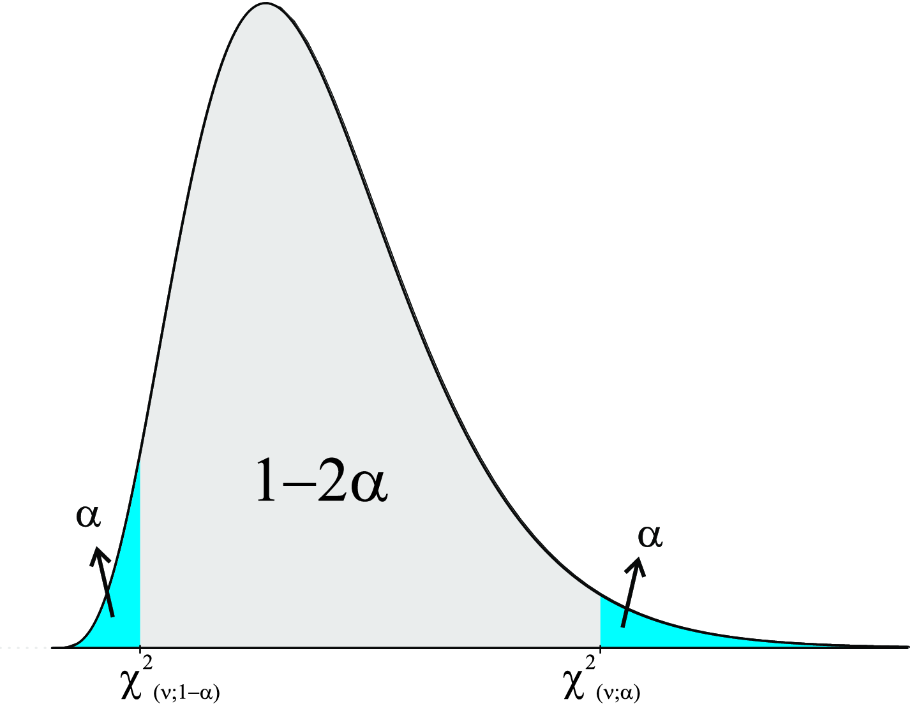

```

O valor $\chi^{2}_{(\nu;\alpha)}$ na distribuição de $\chi^2$ representa o ponto que deixa à direita a área $\alpha$ com $\nu$ graus de liberdade, que em notação diz-se que:

$$
P\left(\chi^{2} > \chi^{2}_{(\nu;\alpha)}\right)=\alpha.
$$

::: {#exm-chi01}

Seja uma amostra $n = 20$ e $\alpha = 5,0\%$.

Assim, tem-se que:

$$
\nu=n-1=20-1=19
$$

graus de liberdade;

$$
\alpha=5,0\%=0,05;
$$

e

$$
\chi^{2}_{(\nu;\alpha)}=\chi^{2}_{(19;0,05)}=?
$$

Consultando a Tabela de $\chi^2$, tem-se que o valor de $\chi^2$ que deixa uma probabilidade acima dele de $5,0\%$ com $19$ graus de liberdade é igual a $30,1435$.

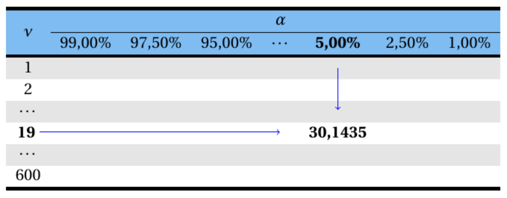

Logo,

$$
\chi^{2}_{(19;0,05)}=30,1435,
$$

sendo sua representação gráfica apresentada na @fig-chisq86.


```{r}
#| label: fig-chisq86
#| fig-cap: "Área correspondente à probabilidade de $\\chi^2 > 30,1435$ com $\\nu = 19$ graus de liberdade."
#| echo: false
#| out-width: "60%"
#| fig-align: "center"

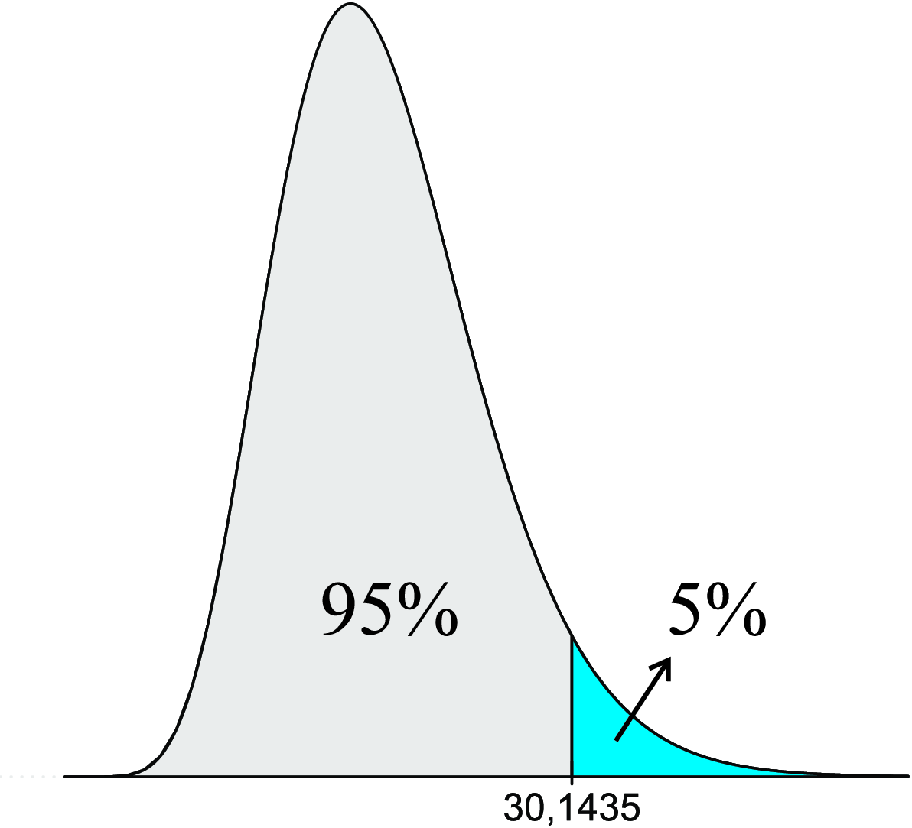

```

:::

::: {#exm-chi02}

Seja uma amostra $n = 20$ e $\alpha = 95,0\%$.

Assim, tem-se que:

$$
\nu=n-1=20-1=19
$$

graus de liberdade;

$$
\alpha=95,0\%=0,95;
$$

e

$$
\chi^{2}_{(\nu;\alpha)}=\chi^{2}_{(19;0,95)}=?
$$

Consultando a Tabela de $\chi^2$, tem-se que o valor de $\chi^2$ que deixa uma probabilidade acima dele de $95,0\%$ com $19$ graus de liberdade é igual a $10,1170$.

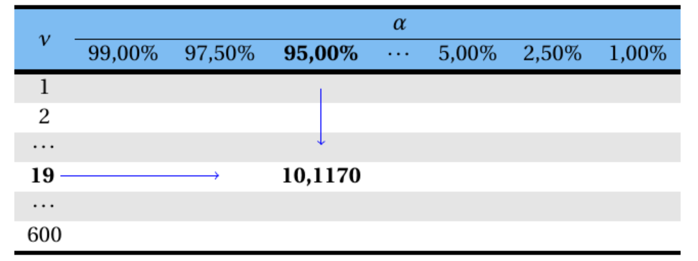

Logo,

$$
\chi^{2}_{(19;0,95)}=10,1170,
$$

sendo sua representação gráfica apresentada na @fig-chi87.


```{r}
#| label: fig-chi87
#| fig-cap: "Área correspondente à probabilidade de $\\chi^2 < 10,1170$, com $\\nu = 19$ graus de liberdade."
#| echo: false
#| out-width: "60%"
#| fig-align: "center"

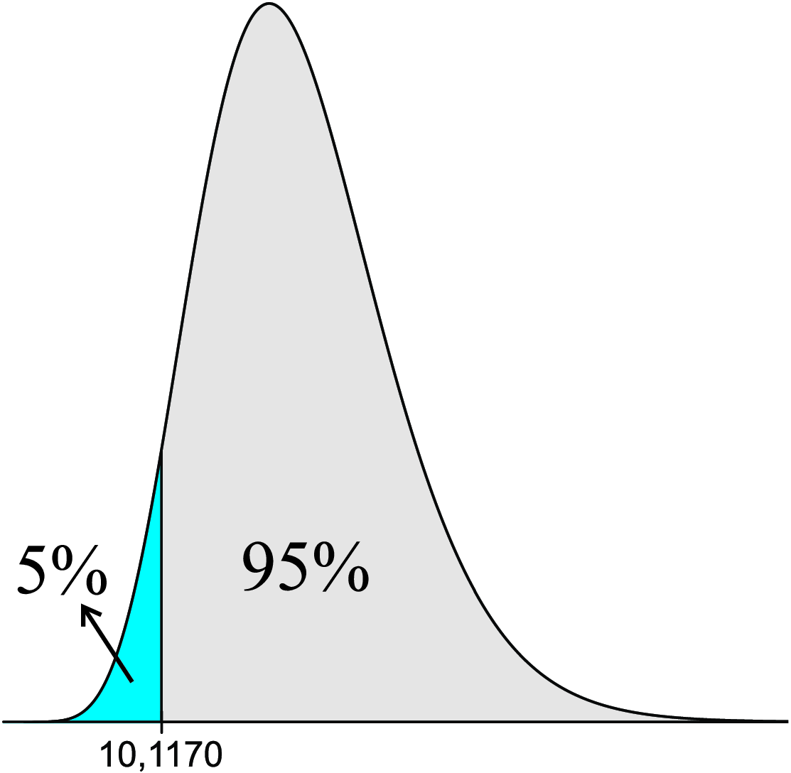

```

:::

::: {#exm-chi03}

Considerando uma amostra $n = 20$, os valores de $\chi^2$, cuja área (probabilidade) entre esses valores é de $90,0\%$, são dados por:

$$
P\left(
\chi^{2}_{(19;0,95)}
<
\chi^{2}
<
\chi^{2}_{(19;0,05)}
\right)
=
P\left(
10,1170
<
\chi^{2}
<
30,1435
\right)
=
0,90
=
90,0\%.
$$

Sua representação gráfica é apresentada na @fig-chi88.

```{r}
#| label: fig-chi88
#| fig-cap: "Área correspondente à probabilidade de $10,1170 < \\chi^2 < 30,1435$, com $\\nu = 19$ graus de liberdade."
#| echo: false
#| out-width: "60%"
#| fig-align: "center"

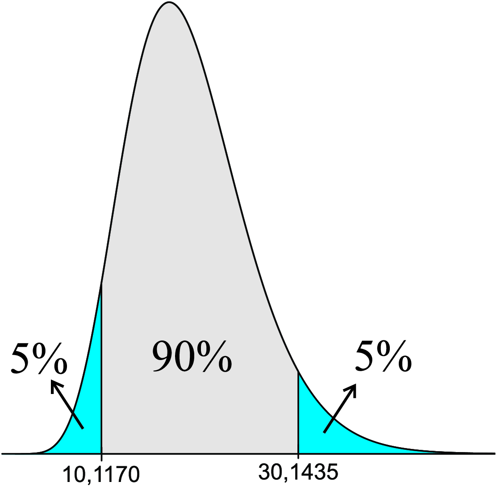

```

:::

## Distribuição Amostral da Variância

Um resultado importante envolvendo a distribuição de $\chi^2$ é descrito a seguir.

Seja $X$ uma variável aleatória normalmente distribuída, ou seja,

$$
X \sim N(\mu;\sigma^2),
$$

associada a uma população. Se desta população são retiradas várias amostras aleatórias independentes de tamanho $n$, e para cada amostra é calculada a variância amostral $s^2$, então a variável aleatória definida pela Equação @eq-quiquad

$$
\chi^{2}=\frac{(n-1)s^2}{\sigma^2},
$$ {#eq-quiquad}

segue uma distribuição $\chi^2$ com $\nu=n-1$ graus de liberdade, sendo $\sigma^2$ a variância populacional.

A distribuição $\chi^2$ tem muita importância em Estatística, como veremos nos próximos capítulos, principalmente para realizar inferências sobre a variância populacional $\sigma^2$.

### Distribuição t-Student

A distribuição $t$-Student é uma distribuição teórica de probabilidades, especificamente utilizada quando se têm pequenas amostras ($n < 30$), e quando se desconhece o valor da variância populacional $\sigma^2$. A distribuição $t$ é definida a seguir.

Sejam $Z$ e $Y$ duas variáveis aleatórias independentes, tal que:

$$
Z \sim N(0,0;1,0)
\quad \text{e} \quad
Y \sim \chi^{2}_{1},
$$

então a variável aleatória definida por

$$
t=\frac{Z}{\sqrt{\frac{Y}{\nu}}}
$$

segue a distribuição $t$, cuja função densidade de probabilidade é dada por:

$$
f(t)=
\frac{
\Gamma\left(\frac{\nu+1}{2}\right)
}{
\sqrt{\pi \nu}
\Gamma\left(\frac{\nu}{2}\right)
}
\frac{
1
}{
\left(
1+\frac{t^2}{\nu}
\right)^{\frac{(\nu+1)}{2}}
},
\quad -\infty < t < \infty,
$$

em que:

- $t$ é a variável aleatória com distribuição $t$-Student com $\nu$ graus de liberdade;
- $\Gamma$ é a função Gama;
- $\nu$ representa o parâmetro da distribuição, chamado de graus de liberdade, dado por: $\nu=n-1$.

A média e a variância de uma distribuição $t$ são dadas por:

$$
E(t)=\mu=0,
\quad \text{para} \quad \nu > 1,
$$

e

$$
V(t)=\sigma^{2}=\frac{\nu}{\nu-2},
\quad \text{para} \quad \nu > 2,
$$

respectivamente.

As características da distribuição $t$ são:

1. As curvas de $t$ são simétricas em relação à média, têm forma de sino e assemelham-se à curva normal. Os valores de $t$ são positivos à direita da média e negativos à sua esquerda;

2. Para cada tamanho $n$ de amostra existe uma curva de $t$. A função $f(t)$ depende de $n$;

3. À medida que $n$ cresce, a distribuição $t$ se aproxima da distribuição normal padronizada ($Z$);

4. O valor $\nu = n - 1$ (número de graus de liberdade) é usado para obtenção de probabilidades em tabelas.

Valores de probabilidades na distribuição $t$ são obtidos em tabelas. A tabela de $t$ fornece o valor acima do qual se encontra a área $\alpha$, conforme a @fig-tstudent.


```{r}
#| label: fig-tstudent
#| fig-cap: "Área $\\alpha$ correspondente à probabilidade de $t>t_{(\\nu;\\alpha)}$."
#| echo: false
#| out-width: "60%"
#| fig-align: "center"

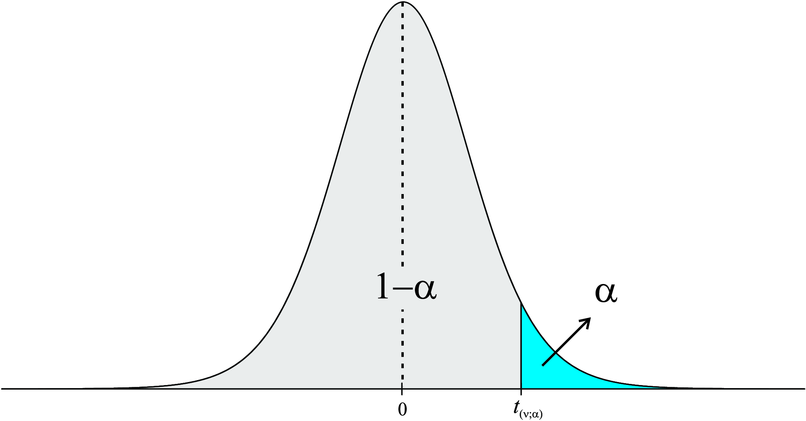

```


O valor $t_{(\nu;\alpha)}$ representa, na distribuição $t$, o ponto que deixa à sua direita a área $\alpha$ com $\nu$ graus de liberdade.

Em notação, tem-se que:

$$
P\left(t>t_{(\nu;\alpha)}\right)=\alpha.
$$

::: {#exm-tdist01}

Seja uma amostra $n = 15$. Qual o valor de $t$ acima do qual se tem $5,0\%$ de área (probabilidade)?

Assim, tem-se que:

$$
\nu = n - 1 = 15 - 1 = 14
$$

graus de liberdade,

e

$$
\alpha=5,0\%=0,05.
$$

Logo,

$$
t_{(\nu;\alpha)}=t_{(14;0,05)}=?
$$

Consultando a tabela da distribuição $t$, o valor de $t$ que deixa uma área (probabilidade) acima dele de $5,0\%$ com $14$ graus de liberdade é igual a $1,7613$.

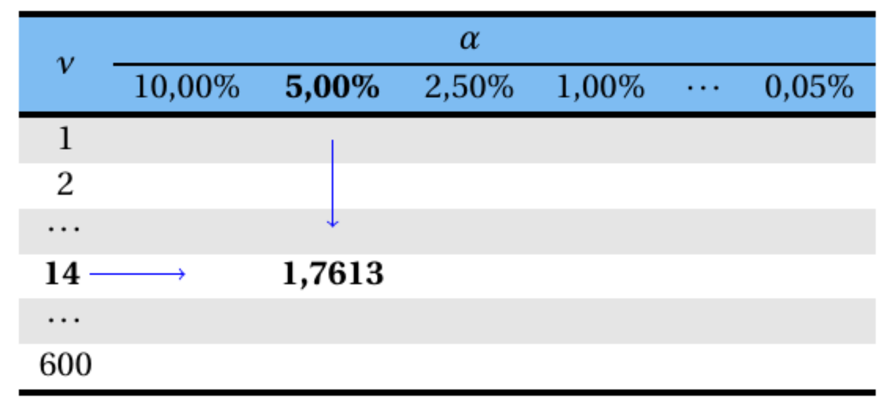

Logo,

$$
t_{(14;0,05)}=1,7613,
$$

sendo sua representação gráfica apresentada na @fig-exem89.


```{r}
#| label: fig-exem89
#| fig-cap: "Área correspondente à probabilidade de $t > 1,7613$, com $\\nu = 14$ graus de liberdade."
#| echo: false
#| out-width: "60%"
#| fig-align: "center"

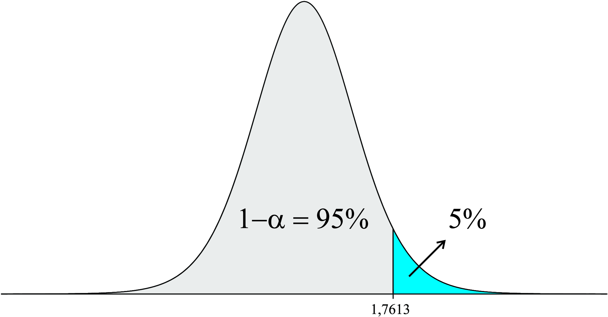

```

:::

::: {#exm-tdist02}

Para uma amostra $n = 15$, qual o valor de $t$ acima do qual tem-se $95,0\%$ de área (probabilidade)?

Assim, tem-se que:

$$
\nu = n - 1 = 15 - 1 = 14
$$

graus de liberdade,

e

$$
\alpha=95,0\%=0,95.
$$

Logo,

$$
t_{(\nu;\alpha)}=t_{(14;0,95)}=?
$$

Considerando-se a propriedade de simetria da distribuição $t$, tem-se que o valor de $t$ que deixa uma área (probabilidade) abaixo dele de $5,0\%$ com $14$ graus de liberdade é igual a $-1,7613$.

Logo,

$$
t_{(14;0,95)}=-1,7613,
$$

sendo sua representação gráfica apresentada na @fig-exem810.

```{r}
#| label: fig-exem810
#| fig-cap: "Área correspondente à probabilidade de $t > -1,7613$, com $\\nu = 14$ graus de liberdade."
#| echo: false
#| out-width: "60%"
#| fig-align: "center"

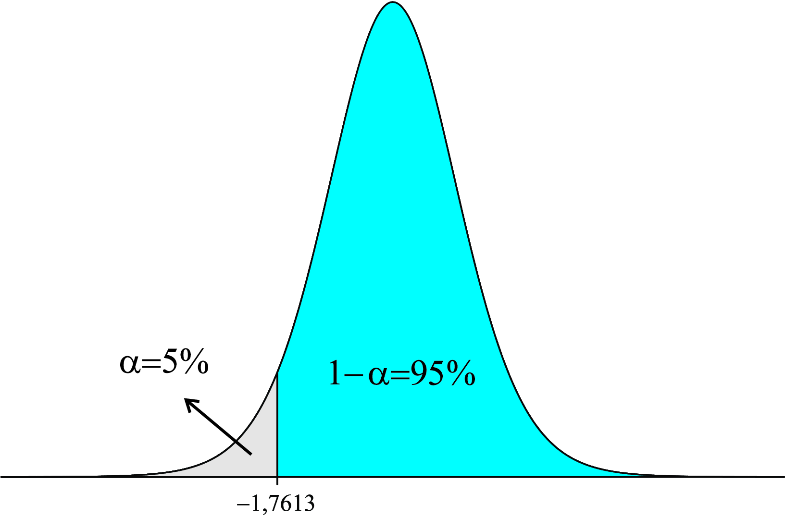

```

:::

::: {#exm-tdist03}

Para uma amostra $n = 15$, quais os valores de $t$ simétricos que encerram uma área (probabilidade) de $90,0\%$?

Assim, tem-se que:

$$
P\left(
t_{(14;0,95)}
<
t
<
t_{(14;0,05)}
\right)
=
P\left(
-1,7613
<
t
<
1,7613
\right)
=
0,90
=
90,0\%.
$$

Sua representação gráfica é apresentada na @fig-exem811.

```{r}
#| label: fig-exem811
#| fig-cap: "Área correspondente à probabilidade de $-1,7613 < t < 1,7613$, com $\\nu = 14$ graus de liberdade."
#| echo: false
#| out-width: "60%"
#| fig-align: "center"

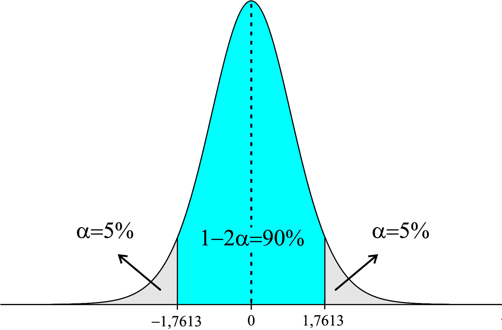

```

:::

Um resultado importante envolvendo a distribuição $t$ é descrito a seguir.

Seja $X$ uma variável aleatória normalmente distribuída, ou seja,

$$
X \sim N(\mu;\sigma^2),
$$

associada a uma população. Se desta população são retiradas várias amostras aleatórias independentes de tamanho $n$, e para cada amostra são calculadas a média amostral $\bar{x}$ e a variância amostral $s^2$, então a variável aleatória definida pela Equação @eq-t

$$
t=
\frac{
\bar{x}-\mu
}{
\frac{s}{\sqrt{n}}
},
$$ {#eq-t}

segue uma distribuição $t$ com $\nu=n-1$ graus de liberdade, sendo $s$ o desvio padrão amostral.

A distribuição $t$ é utilizada para se realizar inferências sobre a média, quando $\sigma^2$ for desconhecida, e a população normalmente distribuída, independentemente do tamanho da amostra, como será visto nos próximos capítulos.

### Distribuição F-Snedecor

Definida teoricamente como sendo o quociente entre duas variáveis aleatórias independentes, com distribuições de $\chi^2$ com $\nu$ graus de liberdade, cada uma delas dividida pelos seus respectivos números de graus de liberdade.

Sua função densidade de probabilidade é dada por:

$$
f(F)=
\frac{
\Gamma\left(\frac{\nu_{1}+\nu_{2}}{2}\right)
}{
\Gamma\left(\frac{\nu_1}{2}\right)
\Gamma\left(\frac{\nu_2}{2}\right)
}
\left(
\frac{\nu_1}{\nu_2}
\right)^{\left(\frac{\nu_1}{2}\right)}
\frac{
F^{\left(\frac{\nu_{1}-2}{2}\right)}
}{
\left(
1+\frac{\nu_1}{\nu_2}F
\right)^{\frac{(\nu_{1}+\nu_{2})}{2}}
},
\quad F \geqslant 0
$$

em que:

- $F$ é uma variável aleatória com distribuição F-Snedecor com $\nu_1$ e $\nu_2$ graus de liberdade;
- $\Gamma$ é a função Gama;
- $\nu_1$ e $\nu_2$ são os parâmetros da distribuição, chamados de graus de liberdade, dados por: $\nu_{1}=n_{1}-1$ e $\nu_{2}=n_{2}-1$, respectivamente.

A distribuição F é assimétrica à direita e depende dos parâmetros $\nu_1$ e $\nu_2$ e da ordem dos mesmos, pois existe uma curva para cada par $(\nu_1; \nu_2)$.

Valores de probabilidades na distribuição F são obtidos em tabelas para as diferentes combinações de $(\nu_1; \nu_2)$.

O valor $F_{(\nu_{1}; \nu_{2}; \alpha)}$ na distribuição F para $\nu_1$ e $\nu_2$ graus de liberdade, é o ponto que deixa a área (probabilidade) $\alpha$ à sua direita, conforme @fig-fdist.


```{r}
#| label: fig-fdist
#| fig-cap: "Área correspondente à probabilidade de $F > F_{(\\nu_1,~\\nu_2;~\\alpha)}$."
#| echo: false
#| out-width: "60%"
#| fig-align: "center"

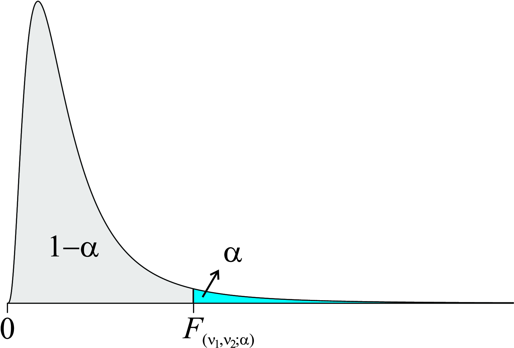

```

Em notação diz-se:

$$
F_{(\nu_{1}, \nu_{2}; \alpha)}
\text{ é um valor tal que: }
P\left[
F>F_{(\nu_{1}, \nu_{2}; \alpha)}
\right]
=
\alpha
$$

::: {#exm-fdist}

Sejam as amostras $n_{1} = 10$ e $n_{2} = 8$, e $\alpha = 5,0\%$.

Assim, tem-se que:

$$
\nu_{1}=n_{1}-1=10-1=9
\text{ graus de liberdade}
$$

$$
\nu_{2}=n_{2}-1=8-1=7
\text{ graus de liberdade}
$$

$$
\alpha = 5,0\% = 0,05
$$

$$
F_{(\nu_{1}; \nu_{2}; \alpha)}
=
F_{(9; 7; 0,05)}
=?
$$

Consultando a tabela da distribuição F, tem-se que o valor de F que deixa uma probabilidade acima dele de $5,0\%$, com $\nu_{1} = 9$ e $\nu_{2} = 7$ graus de liberdade é igual a $3,6767$.

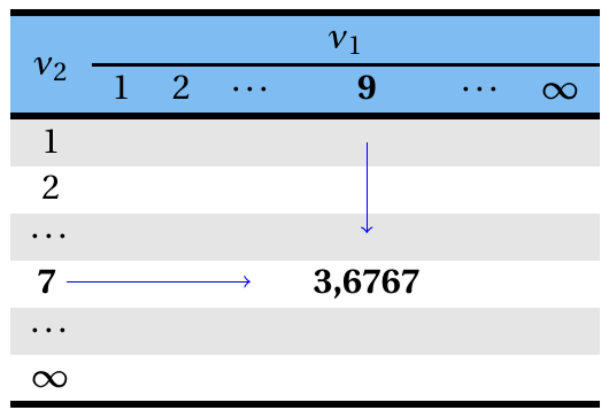

Logo,

$$
F_{(9; 7; 0,05)}=3,6767
$$

sendo sua representação gráfica apresentada na @fig-exem812.

```{r}
#| label: fig-exem812
#| fig-cap: "Área correspondente à probabilidade de $F > 3,6767$ para $\\nu_1 = 9$ e $\\nu_2 = 7$ graus de liberdade."
#| echo: false
#| out-width: "60%"
#| fig-align: "center"

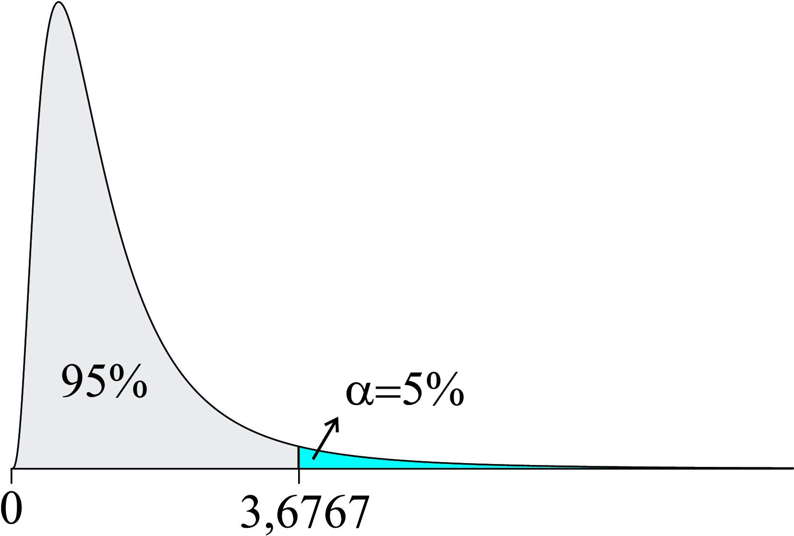

```

:::

::: {#exm-fdist02}

Sejam as amostras $n_{1} = 18$ e $n_{2} = 20$, e $\alpha = 1,0\%$.

Assim, tem-se que:

$$
\nu_{1}=n_{1}-1=18-1=17
\text{ graus de liberdade}
$$

$$
\nu_{2}=n_{2}-1=20-1=19
\text{ graus de liberdade}
$$

$$
\alpha=1,0\%=0,01
$$

$$
F_{(\nu_{1}; \nu_{2}; \alpha)}
=
F_{(17; 19; 0,01)}
=?
$$

Consultando a tabela da distribuição F, tem-se que o valor de F que deixa uma probabilidade acima dele de $1,0\%$, com $\nu_1 = 17$ e $\nu_2 = 19$ graus de liberdade, é igual a $3,0836$.

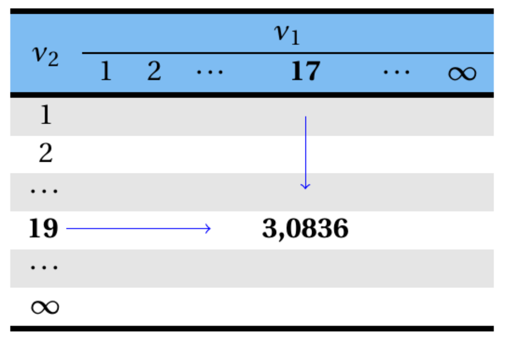

Logo,

$$
F_{(17; 19; 0,01)}=3,0836
$$

sendo sua representação gráfica apresentada na @fig-exem813.

```{r}
#| label: fig-exem813
#| fig-cap: "Área correspondente à probabilidade de $F > 3,0836$ para $\\nu_1 = 17$ e $\\nu_2 = 19$ graus de liberdade."
#| echo: false
#| out-width: "60%"
#| fig-align: "center"

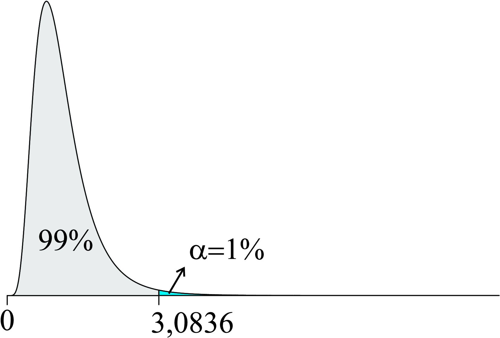

```

:::

Um resultado importante envolvendo a distribuição F é descrito a seguir.

Seja $X_1$ uma variável aleatória normalmente distribuída, ou seja,

$$
X_{1} \sim N(\mu_{1}; \sigma_{1}^2)
$$

associada a uma população 1.

E seja $X_2$ uma variável aleatória normalmente distribuída, ou seja,

$$
X_{2} \sim N(\mu_{2}; \sigma_{2}^2)
$$

associada a uma população 2.

Se destas populações são retiradas várias amostras aleatórias independentes de tamanhos $n_1$ e $n_2$, respectivamente, e para cada amostra são calculadas as variâncias amostrais, $s_{1}^2$ e $s_{2}^2$, então a variável aleatória definida por @eq-F:

$$
F=
\frac{
s_{1}^2 / \sigma_{1}^2
}{
s_{2}^2 / \sigma_{2}^2
}
$$ {#eq-F}

segue uma distribuição F com $\nu_{1} = n_{1} - 1$ e $\nu_{2} = n_{2} - 1$ graus de liberdade, sendo $\sigma_{1}^2$ e $\sigma_{2}^2$ as variâncias associadas às populações 1 e 2, respectivamente.

A distribuição F é uma das mais importantes distribuições amostrais em Estatística. Seu desenvolvimento permitiu um grande avanço na Estatística Aplicada, principalmente pela aplicação na metodologia da análise de variância. Como será visto mais adiante, a distribuição F é utilizada para comparar duas variâncias populacionais.

## Exercícios propostos {-}

:::{#exr-}

Os pesos dos animais de um rebanho bovino tem distribuição normal com média 245,0 kg e variância 576,0 kg$^2$.

a) Qual a probabilidade de um animal pesar menos de 240,0 kg;

b) Qual a probabilidade de um lote de 18 animais ter média menor que 240,0 kg;

c) Uma balança tem capacidade máxima para pesar 2.100,0 kg. Qual a probabilidade de ultrapassar a capacidade da balança uma amostra de:

- 8 bovinos;
- 9 bovinos;
- 10 bovinos.

d) Que orientação você passaria baseando nos resultados do item (c) para o funcionamento racional da balança;

e) Se o rebanho tem 210 bovinos, qual a probabilidade de um lote de 16 animais ter média menor que 240,0 kg.

:::

:::{#exr-}

Uma máquina de empacotar café o faz segundo uma distribuição normal, com média $\mu$ e variância 100,0 g$^2$.

a) Em quanto deve ser regulado o peso médio $\mu$ para que apenas 10,0\% dos pacotes tenham menos do que 500,0 g;

b) Com a máquina assim regulada, qual é a probabilidade de que o peso total de 4 pacotes escolhidos ao acaso seja inferior a 2,0 kg.

:::

:::{#exr-}

A produção de tubérculos de batata segue uma distribuição normal de média 200,0 g e variância 6.400,0 g$^2$.

a) Qual a probabilidade de uma amostra de 40 tubérculos tomados ao acaso possuir uma média entre 200,0 e 210,0 g;

b) Qual a probabilidade desta mesma amostra possuir um média entre 185,0 e 220,0 g.

:::

:::{#exr-}

Um Engenheiro Agrícola quer dimensionar galpões de frangos para uma granja, de tal maneira que cada galpão seja a carga de frangos de um caminhão. O máximo que um caminhão pode transportar é 5.000,0 kg de peso de frangos, descontado o peso das gaiolas. O Engenheiro sabe que os frangos têm peso final segundo uma distribuição normal de média 2,10 kg e variância 0,0225 kg$^2$. Se os galpões forem dimensionados para conterem 2.375 pintinhos, o total de peso de frangos excederá a capacidade de carga do caminhão?

:::

:::{#exr-}

Um Engenheiro Florestal conduziu um estudo em um povoamento florestal, e verificou que o DAP (diâmetro à altura do peito) médio das árvores é de 18,0 cm e o desvio padrão de 2,5 cm. A probabilidade de que o DAP médio em uma amostra com 11 árvores seja maior que um certo valor é de 10,0\%. Qual é este valor?

:::

:::{#exr-}

Sabe-se que o rendimento, em ton/ha, de dois sistemas de plantio de arroz, sequeiro e irrigado por inundação, obedecem a distribuição normal, com médias 2,5 e 3,0 ton/ha, e variâncias 4,0 e 10,0 (ton/ha)$^2$, respectivamente. Foram cultivadas 10 parcelas com arroz de sequeiro e 9 parcelas com arroz irrigado por inundação. Qual é a probabilidade de que a diferença do rendimento médio nestas parcelas seja menor do que 0,5 ton/ha.

:::

:::{#exr-}

Sabe-se que 20,0\% das plantas de uma lavoura de milho estão contaminadas por uma certa doença.

a) Qual a probabilidade de uma amostra de 100 plantas apresentar proporção de contaminação?

- acima de 15,0\%;
- acima de 30,0\%;
- abaixo de 14,0\%.

b) Qual a probabilidade de uma amostra de 50 plantas apresentar proporção de contaminação?

- acima de 15,0\%;
- acima de 30,0\%;
- abaixo de 14,0\%.

:::

:::{#exr-}

Use a Tabela de $\chi^2$ para obter as seguintes probabilidades com representação gráfica.

a) $\chi_{0,01}^2$ com $\nu=2$;

b) $\chi_{0,05}^2$ com $n=5$;

c) $\chi_{0,975}^2$ com $n=16$;

d) $\chi_{0,50}^2$ com $\nu=10$.

:::

:::{#exr-}

Use a Tabela de $t$ para obter as seguintes probabilidades com representação gráfica.

a) $t_{0,10}$ com $n=5$;

b) $t_{0,025}$ com $\nu=8$;

c) $t_{0,95}$ com $n=12$;

d) $t_{0,50}$ com $\nu=20$.

:::

:::{#exr-}

Use a Tabela de F para obter as seguintes probabilidades com representação gráfica.

a) $F_{0,01}$ com $n_{1}=5$ e $n_{2}=21$;

b) $F_{0,05}$ com $\nu_{1}=12$ e $\nu_{2}=4$;

c) $F_{0,05}$ com $n_{1}=7$ e $n_{2}=11$;

d) $F_{0,01}$ com $\nu_{1}=6$ e $\nu_{2}=10$.

:::